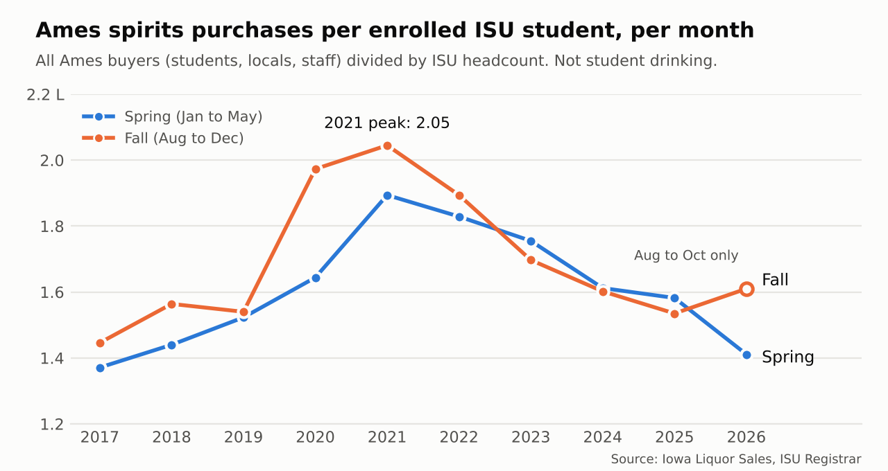
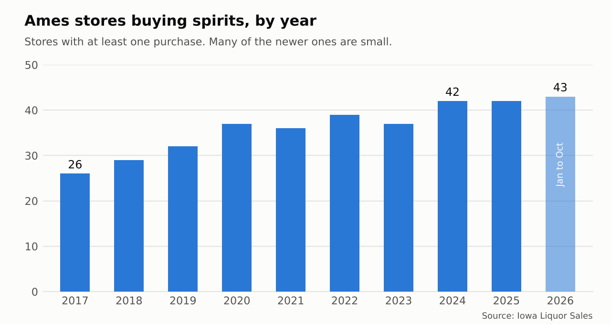
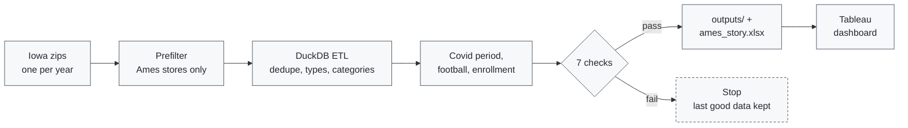

<p align="center">
  
</p>

<p align="center">
  
  
  
  
  
</p>

<p align="center">
  <b>How has spirits buying in Ames, Iowa changed over 10 years?<br>
  And do Iowa State students, football weeks, or covid have anything to do with it?</b>
</p>

<p align="center">
  <a href="https://public.tableau.com:9443/views/AmesIowa/Story?:language=en-US&:sid=&:redirect=auth&:display_count=n&:origin=viz_share_link">Live Tableau dashboard</a>
</p>

---

## At a glance

<table align="center">
  <tr>
    <td align="center"><h2>679K</h2>Ames rows, 2016 to Oct 2026</td>
    <td align="center"><h2>$106.9M</h2>in store purchases</td>
    <td align="center"><h2>43</h2>stores buying in 2026<br>(26 in 2017)</td>
    <td align="center"><h2>7</h2>checks on every refresh</td>
  </tr>
</table>

## What I found

<p align="center">
  
</p>

**Ames spirits volume peaked in 2021 and is now below 2018. Buyers traded down and bought smaller bottles, prices rose about 30%, and more stores split the same bottles.**

- Jan to Oct liters: 476K (2017), 566K (2021), 418K (2026). Down 12% from 2017.
- Price per liter rose 30% ($14.43 to $18.75). About 84% was same-category price, 16% category mix.
- Traded down: value tier 44% to 52% of liters, premium 16% to 14%. Mini bottles almost doubled.
- Stores grew 26 to 43, liters per store fell 47%.
- Students set the rhythm, not the trend: June and July run about 22% lower every year, but enrollment size does not predict volume.
- Football is a nudge: about 14% more on the Wed and Thu before a game.

Findings compare 2017 to 2026. 2016 is in the data but left out of the story charts (see Limits).

<p align="center">
  
</p>

### Tested and rejected
Price vs volume (r = -0.27, gone inside one category), stores vs liters (r = -0.10), a +72% post-game lift (tiny weekday baseline), and a +153% pre-game lift (a weekday artifact). Full list and limits: [docs/findings.md](docs/findings.md).

---

## How the pipeline works



| Step | What | Why |
|---|---|---|
| Prefilter | Stream each zip, keep rows from stores ever labeled AMES | 5.5 GB of zips becomes 137 MB. A normal month only re-reads the new zip |
| 1 to 3 | Read CSV and JSON as text, keep Ames stores, remove exact duplicate rows | Keep by `store_no`, old rows have no city. Some part files were full copies |
| 4 | Real types, covid period, clean category names | Dates came as `2017-01-23` and `1/3/2017` |
| 5 to 8 | Football game windows (game day -3 to +3), joined to sales | Stores order ahead of a game, not on game day |
| 9 to 10 | Small tables and enrollment per term | Keeps Tableau simple |
| 10b to 10f | Price vs mix, trade-down tiers, bottle size, drivers, game by game | Tests each idea before it becomes a claim |
| Checks | 7 checks, outputs written only if all pass | A bad refresh never reaches Tableau |

Covid periods: before 2020-03-17, until 2023-05-11, after.

## Monthly refresh (automated)

Drop the new Iowa zip in a folder and click one button in n8n. It filters Ames rows, runs the ETL in Docker, checks the data, and rebuilds the Tableau files. If a check fails, the workflow stops and nothing changes.

Setup and steps: [automation/README.md](automation/README.md)

## Run it by hand

1. Put the Iowa liquor CSV or JSON files in `data/raw/`
2. Install and run:

```bash
pip install -r requirements.txt
py run_etl.py          # Windows
python3 run_etl.py     # Mac or Linux
```

The script runs `sql/etl.sql`, prints PASS or FAIL for each check, and writes `outputs/` only if every check passes.

---

<details>
<summary><b>Checks (run on every refresh)</b></summary>

1. Dollar totals match in every table
2. No null sale dates
3. No rows lost in the typing step
4. One name per category code, per coding period
5. No exact duplicate rows left
6. One game per date, so the football join cannot double count
7. No year lost more than 1% of its rows vs the last good run

Warning only: months with no ISU headcount.

</details>

<details>
<summary><b>Data quality log (what was wrong and what I did)</b></summary>

- Mixed date formats across years. Parse both, check for nulls.
- Exact duplicate rows from overlapping part files. Dedupe on the full row, not invoice + item. The same item can appear twice on one invoice with different quantities.
- 3,427 rows share an invoice and item but differ in quantity. I checked samples, they are real separate lines. Kept.
- Category names: LIQUEUR vs LIQUEURS, SPIRIT vs SPIRITS SPECIALTY. Same codes. Standardized.
- Iowa re-coded categories on 2016-08-27 and shifted codes by one slot. 33 codes mean a different category before that date. The name is the source of truth, and the check runs per coding period.
- Rows with no category name. Labeled UNKNOWN.
- Football file: 8 game windows had the wrong length and one had a year typo (Oregon bowl). Rebuilt around one game date.
- Iowa Data Hub links broke in 2026 (`rows.csv` returns 0 bytes, the `rows.json` zip is corrupt). Downloads are manual from the website for now.
- Totals tie to the dollar in every table after every step.

Full write-up: [docs/dmaic.md](docs/dmaic.md)

</details>

<details>
<summary><b>Limits (read before quoting any number)</b></summary>

- Spirits only. No beer, wine, or THC drinks.
- These are store purchases, not what people drink. There is no age in the data, so nothing here says anything about Gen Z.
- Buyers are students, locals, and staff. "Per enrolled student" only divides all Ames purchases by ISU headcount. It does not show student buying. Summer is left out of that view.
- Month to term mapping is rough: Jan to May is Spring, Jun to Jul is Summer, Aug to Dec is Fall.
- 2026 is a partial year. Charts compare Jan to Oct only.
- 2016 has no ISU enrollment data and uses old category names before Aug 2016, so the story starts in 2017.
- `store_no` can change for the same business (Crown Liquor, World Liquor).
- The football link is small and the comparison group is small. Treat it as a hint.

</details>

<details>
<summary><b>Project files</b></summary>

```
ames-liquor-dashboard/
  run_etl.py                  run this (or the n8n workflow)
  make_workbook.py            builds outputs/ames_story.xlsx for Tableau
  sql/etl.sql                 every step, commented
  data/raw/                   Iowa files go here (not in git)
  data/reference/             football schedule and ISU enrollment
  outputs/                    small CSVs and xlsx for Tableau
  automation/                 Docker, n8n workflow, prefilter
  docs/dmaic.md               data quality write-up
  docs/calcs.md               every Tableau calculation and why
  docs/findings.md            findings, tests, limits
  docs/img/                   charts used in this README
  assets/banner.svg           banner
```

</details>

## Next
- Push outputs to Google Sheets so Tableau Public refreshes on its own
- Switch the download back to the Iowa API once the Data Hub links work again