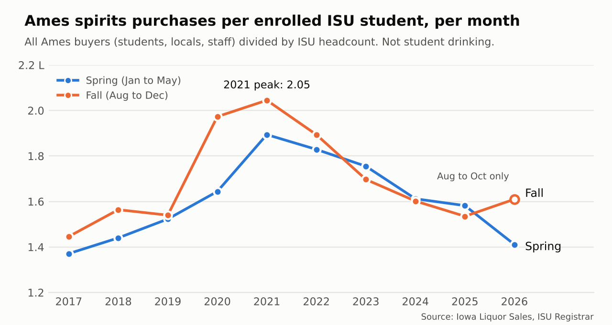
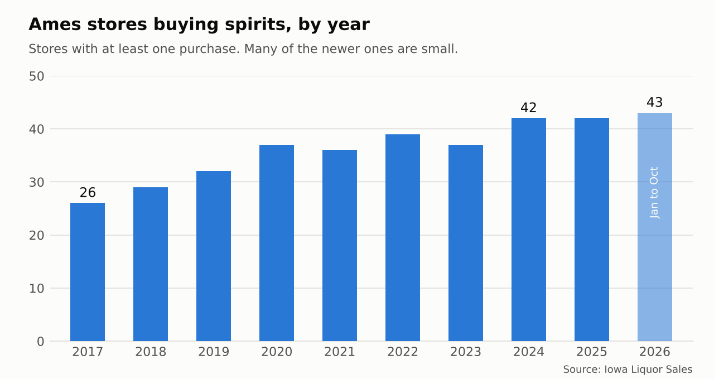
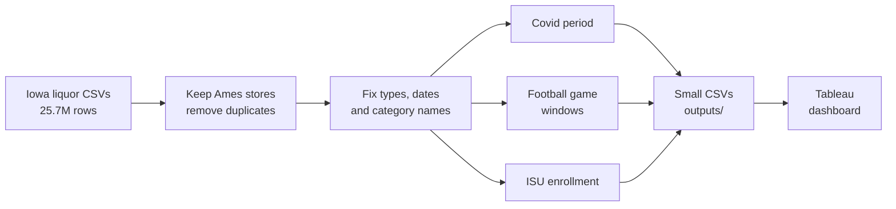

<p align="center">
  
</p>

<p align="center">
  
  
  
  
</p>

<p align="center">
  <b>How has spirits buying in Ames, Iowa changed over 10 years?<br>
  And do Iowa State students, football weeks, or covid have anything to do with it?</b>
</p>

<p align="center">
  <a href="#">View the Tableau dashboard</a> (link coming after I publish it)
</p>

---

## At a glance

<table align="center">
  <tr>
    <td align="center"><h2>25.7M</h2>raw rows cleaned</td>
    <td align="center"><h2>617K</h2>Ames rows kept</td>
    <td align="center"><h2>$98.8M</h2>in purchases, 2017 to Oct 2026</td>
    <td align="center"><h2>43</h2>stores buying in 2026<br>(26 in 2017)</td>
  </tr>
</table>

## What I found

<p align="center">
  
</p>

**Ames spirits volume peaked in 2021 and is now below 2018. Buyers traded down and bought smaller bottles, prices rose about 30%, and more stores split the same bottles.**

- Jan to Oct liters: 476K (2017), 566K (2021), 418K (2026). Down 12% from 2017.
- Price per liter rose 30% ($14.43 to $18.75). About 84% was same-category price, 16% category mix.
- Traded down: value tier 44% to 52% of liters, premium 16% to 14%. Mini bottles almost doubled.
- Stores grew 26 to 43, liters per store fell 47%.
- Students set the rhythm, not the trend: June and July run about 22% lower every year, but enrollment size does not predict volume.
- Football is a nudge: about 14% more on the Wed and Thu before a game.

<p align="center">
  
</p>

### Tested and rejected
Price vs volume (r = -0.27, gone inside one category), stores vs liters (r = -0.10), a +72% post-game lift (tiny weekday baseline), and a +153% pre-game lift (a weekday artifact). Full list and limits: [docs/findings.md](docs/findings.md).

---

## How the pipeline works



| Step | What | Why |
|---|---|---|
| 1 | Read every file as text | Old files have blanks and 2 date formats |
| 2 to 3 | Keep Ames stores, remove exact duplicate rows | Keep by `store_no`, because old rows have no city. Two years had a part file that was a full copy |
| 4 | Real types, covid period, clean category names | Dates came as `2017-01-23` and `1/3/2017`. Four category codes were spelled two ways |
| 5 to 8 | Football game windows (game day -3 to +3), joined to sales | Stores order ahead of a game, not on game day |
| 9 to 10 | Small tables and enrollment per term | Keeps Tableau simple |
| 10b to 10f | Price vs mix, trade-down tiers, bottle size, drivers, game by game | Tests each idea before it becomes a claim |

Covid periods: before 2020-03-17, until 2023-05-11, after.

## Run it

1. Put the Iowa liquor CSV files in `data/raw/`
2. Install and run:

```bash
pip install -r requirements.txt
py run_etl.py          # Windows
python3 run_etl.py     # Mac or Linux
```

The script runs `sql/etl.sql`, writes small CSVs to `outputs/`, and prints PASS or FAIL for each check. Tableau reads the files in `outputs/`.

---

<details>
<summary><b>Data quality log (what was wrong and what I did)</b></summary>

- Mixed date formats across years. Parse both, check for nulls.
- Exact duplicate rows from overlapping part files. Dedupe on the full row, not invoice + item. The same item can appear twice on one invoice with different quantities.
- 3,427 rows share an invoice and item but differ in quantity. I checked samples, they are real separate lines. Kept.
- Category names: LIQUEUR vs LIQUEURS, SPIRIT vs SPIRITS SPECIALTY. Same codes. Standardized.
- 305 rows with no category. Labeled UNKNOWN.
- Football file: 8 game windows had the wrong length and one had a year typo (Oregon bowl). Rebuilt around one game date.
- Totals tie to the dollar in every table after every step.

</details>

<details>
<summary><b>Limits (read before quoting any number)</b></summary>

- Spirits only. No beer, wine, or THC drinks.
- These are store purchases, not what people drink. There is no age in the data, so nothing here says anything about Gen Z.
- Buyers are students, locals, and staff. "Per enrolled student" only divides all Ames purchases by ISU headcount. It does not show student buying. Summer is left out of that view.
- Month to term mapping is rough: Jan to May is Spring, Jun to Jul is Summer, Aug to Dec is Fall.
- 2026 is a partial year. Charts compare Jan to Oct only.
- `store_no` can change for the same business (Crown Liquor, World Liquor).
- The football link is small and the comparison group is small. Treat it as a hint.

</details>

<details>
<summary><b>Project files</b></summary>

```
ames-liquor-dashboard/
  run_etl.py                  run this
  sql/etl.sql                 every step, commented
  data/raw/                   put the Iowa CSV files here (not in git)
  data/reference/             football schedule and ISU enrollment
  outputs/                    small CSVs for Tableau
  docs/calcs.md               every Tableau calculation and why
  docs/img/                   charts used in this README
  assets/banner.svg           animated banner
```

</details>

## Next
Pull new months from the Iowa open data API, rerun the ETL on a schedule, and refresh the dashboard automatically.
